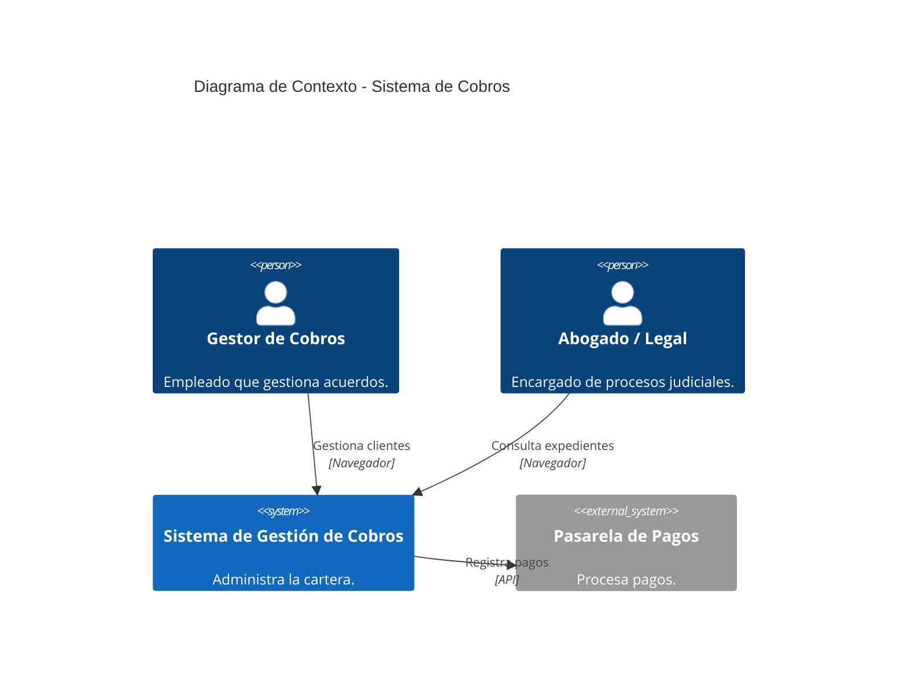
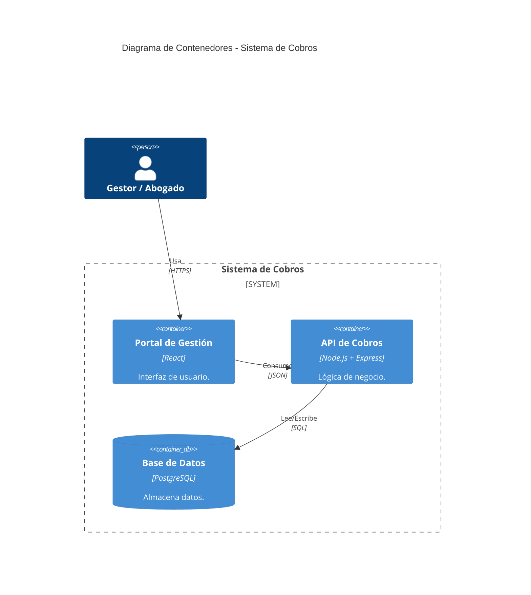

# Arquitectura C4 - Sistema de Gestión de Clientes (Agencia de Cobros)
## Nivel 1: Contexto
Este diagrama muestra cómo interactúa el sistema de la agencia con los usuarios internos y los actores o sistemas externos.
Justificación Nivel 1:
Elegí separar el sistema en dos perfiles (Gestor y Abogado) porque priorizo la Seguridad. Los permisos de un gestor pre-judicial son distintos a los de un abogado, evitando accesos indebidos.
Integré el sistema judicial como un ente externo porque priorizo la Mantenibilidad. Los sistemas gubernamentales cambian, por lo que deben estar desacoplados del core de cobros.

## Nivel 2: Contenedores
Este diagrama muestra las piezas de software desplegables y las tecnologías.
Elegí un proceso en Background (Worker) separado porque priorizo el Rendimiento. El cálculo de moras puede tardar y bloquearía la interfaz si se hiciera en la API.
Utilicé PostgreSQL porque priorizo la Integridad de los Datos. El historial de pagos requiere transacciones estrictas (ACID).

